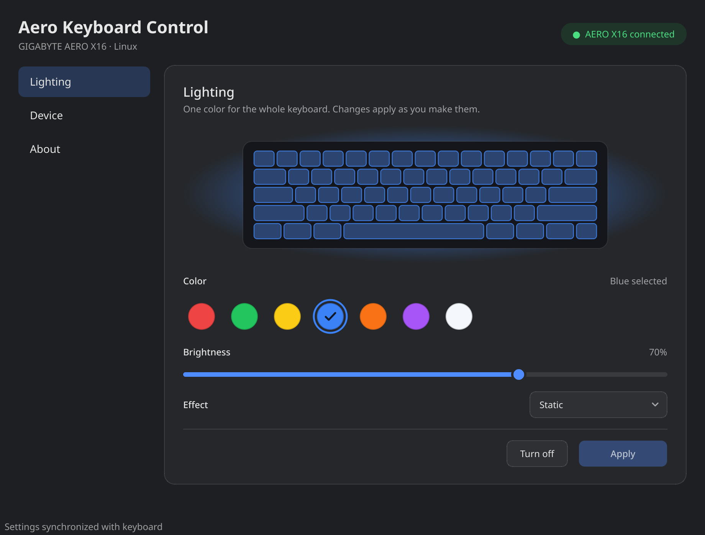
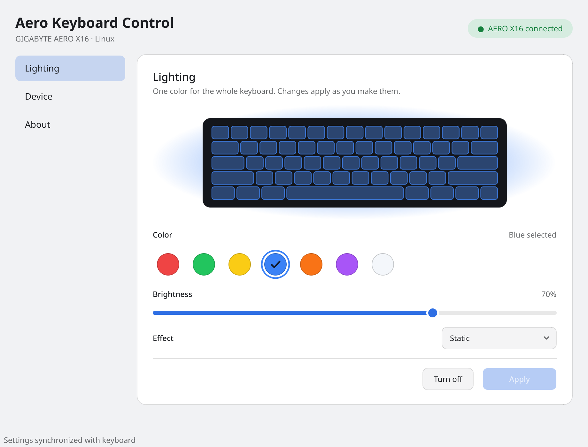
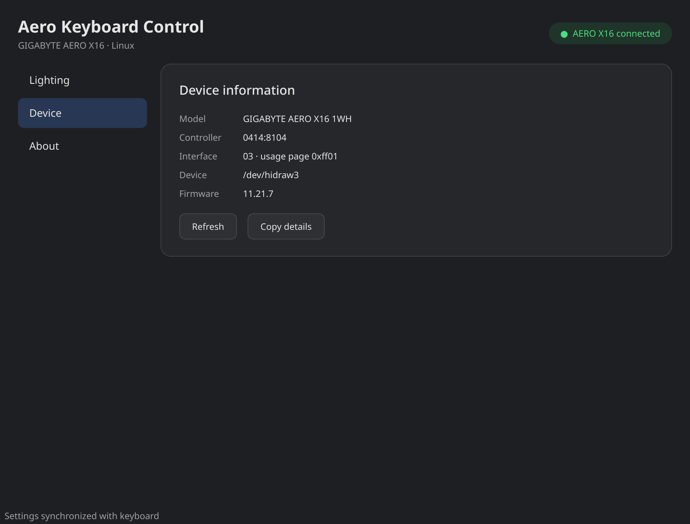
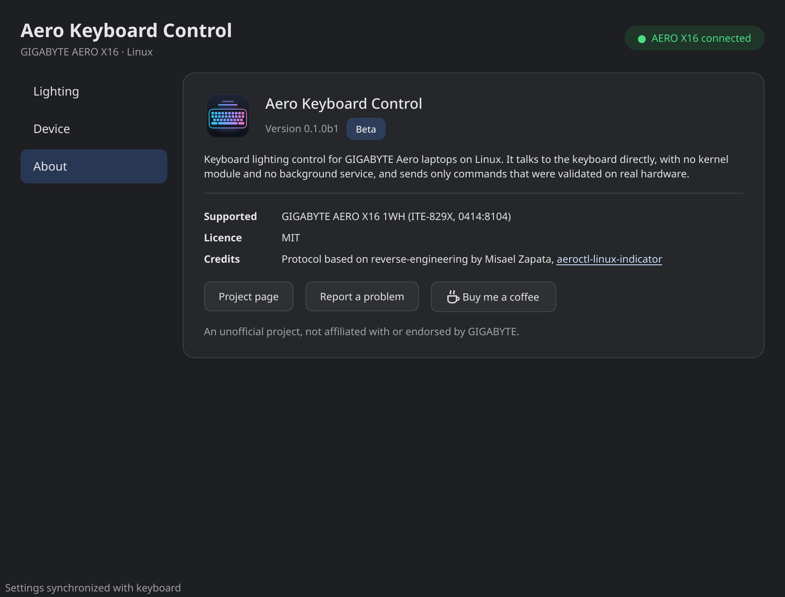

# aero-kbd — Aero Keyboard Control

Cross-distribution Linux control for the RGB keyboard in GIGABYTE Aero laptops.



<details>
<summary>More screenshots</summary>

| Light theme | Device page | About page |
| --- | --- | --- |
|  |  |  |

</details>

The interface follows your desktop's light or dark theme and accent color.

The initial hardware target is the GIGABYTE AERO X16 1WH with the ITE-829X
keyboard controller (`0414:8104`). The first supported distributions will be
Fedora and Arch-based systems, including Omarchy and CachyOS.

## Status

This is a beta release (`0.1.0b1`): it works on the one validated laptop
below, and reports from other owners are welcome.

The protocol core and guarded static-color commands are validated on a
GIGABYTE AERO X16 1WH running keyboard firmware `11.21.7`. Read-only discovery,
firmware/status queries, static colors, brightness, and off are implemented.
Do not send arbitrary HID reports to the keyboard.

## Development setup

```bash
python3 -m venv .venv
.venv/bin/pip install -e '.[test]'
.venv/bin/pytest
.venv/bin/aero-kbd detect
```

Commands that communicate with the controller require the packaged udev rule.
Until the AERO X16 1WH validation is complete, only the static firmware effect
is allow-listed:

```bash
sudo install -Dm644 packaging/udev/70-aero-keyboard.rules \
  /etc/udev/rules.d/70-aero-keyboard.rules
sudo udevadm control --reload-rules
sudo udevadm trigger --subsystem-match=hidraw --action=add
```

The rule is restricted to USB interface `03`, the controller's `0xFF01` RGB
channel. It does not grant access to the normal typing interfaces. Log out and
back in if the active-session ACL is not applied immediately.

Then run:

```bash
aero-kbd firmware
aero-kbd status
aero-kbd set static white --brightness 50
aero-kbd off
```

## Install

### Arch, CachyOS, Omarchy and other Arch-based systems (AUR)

```bash
yay -S aero-kbd        # or: paru -S aero-kbd
```

`aero-kbd-git` follows the development branch. Both install the
GUI, the `aero-kbd` command, the menu entry, and the udev rule.

### Any distribution: one-line installer

```bash
curl -fsSL https://raw.githubusercontent.com/kulunkilabs/aero-kbd/main/scripts/install.sh | sh
```

This needs `python3`, `curl` and `tar`. It downloads the newest release into a
private virtualenv under `~/.local/share/aero-kbd`, adds a menu
entry and icon, and asks for `sudo` once to install the udev rule. Then open
**Aero Keyboard Control** from your application menu.

The installer falls back to `main` only when GitHub reports no release (HTTP
404); other release-lookup failures stop the installation. Set `AERO_KBD_REF`
to select a tag or branch explicitly.

Without `sudo`, the udev rule is saved under
`$XDG_DATA_HOME/aero-kbd/70-aero-keyboard.rules`
(`~/.local/share/aero-kbd/70-aero-keyboard.rules` by default). The installer
prints instructions for installing it from a root shell.

To remove it again:

```bash
curl -fsSL https://raw.githubusercontent.com/kulunkilabs/aero-kbd/main/scripts/install.sh | sh -s -- --uninstall
```

### From a clone

```bash
./scripts/install-app.sh              # user install linked to this checkout
cd packaging/arch-git && makepkg -si  # or a system-wide package
```

## Supported hardware

| Laptop | Controller | Status |
| --- | --- | --- |
| GIGABYTE AERO X16 1WH | ITE-829X (`0414:8104`), firmware 11.21.7 | Static colors, brightness, off |

Other models are not supported yet. If you own one, see
[adding support for another laptop](docs/ADDING_HARDWARE.md) or file a
hardware report issue.

## Desktop application

For development, install the optional Qt dependency and launch the native
Wayland-compatible interface:

```bash
.venv/bin/pip install -e '.[gui,test]'
.venv/bin/aero-kbd-gui
```

The interface shows live device and firmware status, a keyboard preview,
color swatches, brightness, and a Turn off / Turn on button. Color and brightness changes are
written to the keyboard as you make them, and a slider drag is coalesced into
a single report. Apply remains as a fallback and is offered only when a change
has not reached the hardware.

If the keyboard is running a non-static effect, Apply stays available to switch
it to Static.
Only the hardware-validated static effect is currently shown. The normal window
works on KDE, GNOME, and Hyprland without requiring a tray extension.

## Design goals

- A dependency-light hardware library using Linux `hidraw`
- A scriptable CLI that works without a desktop environment
- A Wayland-compatible Qt desktop application with optional tray support
- No kernel module and no permanently running privileged daemon
- Secure device access through `udev` and `TAG+="uaccess"`
- Native RPM and Arch packaging
- Mocked protocol tests that do not require real hardware

See [the project plan](docs/PROJECT_PLAN.md) for milestones and architecture.
Maintainers: see [releasing](docs/RELEASING.md).

## Prior work

The protocol implementation will build on and attribute the MIT-licensed
reverse-engineering work in
[misaelzapata/aeroctl-linux-indicator](https://github.com/misaelzapata/aeroctl-linux-indicator).

## Support

If this is useful to you, you can
[buy me a coffee on Ko-fi](https://ko-fi.com/kulunkilabs).

## License

MIT
